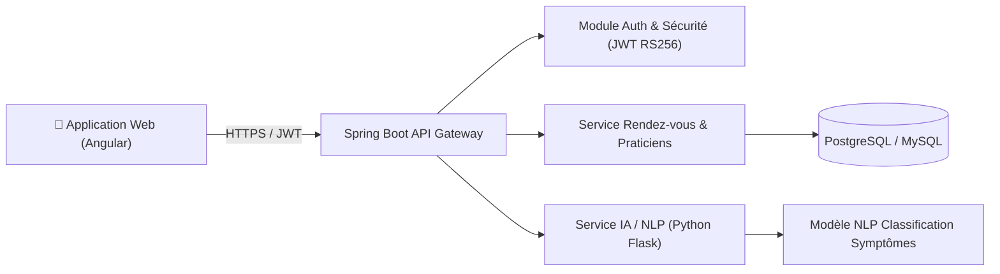

# 🏥 Plateforme d'Assistant Médical Intelligent & Télémédecine

> **Cadre** : Stage Développeuse Full Stack  
> **Entreprise** : 3D Smart Factory (Mohammedia, Maroc)  
> **Période** : 07/2025 – 09/2025  
> **Rôle** : Développeuse Full Stack  
> **Statut** : :material-check-decagram: Livré & Opérationnel  

---

## 1. Contexte & Problématique

Fluidifier le parcours patient et soulager les secrétariats médicaux en proposant une interface conversationnelle intelligente capable de comprendre les symptômes exprimés en langage naturel, d'orienter vers la spécialité médicale adéquate et de planifier un rendez-vous en ligne.

---

## 2. Architecture du Système

---

## 3. Déclinaison du Cycle de Vie (SDLC & DevOps)

1. **Plan & User Stories** : Définition des parcours patients, prise de rendez-vous et respect des normes de confidentialité médicale.
2. **Backend Java / Spring Boot** : Architecture en couches (Controller, Service, Repository, DTO), validation des entrées et gestion fine des transactions.
3. **Sécurisation par Tokens JWT** : Authentification sans état (*stateless*) avec expiration de token et gestion des rôles (*Patient*, *Médecin*, *Administrateur*).
4. **Composant NLP Python** : Microservice d'analyse du langage naturel classifiant les motifs de consultation et proposant la spécialité la plus pertinente.
5. **Frontend Angular** : Interface réactive, formulaire de prise de rendez-vous en plusieurs étapes avec calendrier interactif.
6. **Tests & Qualité** : Tests unitaires JUnit et Mockito, validation des formats de dates et conflits d'horaires.
7. **Conteneurisation** : Déploiement multi-conteneurs avec Docker Compose (Backend, Service IA, BDD).
8. **CI/CD** : Pipeline d'intégration continue assurant le build du bundle frontend Angular et du JAR Spring Boot.
9. **Monitoring** : Journalisation centralisée des événements de rendez-vous et des erreurs d'authentification.
10. **Rétrospective** : Mise en place d'un système de rappels automatiques par notification réduisant le taux de rendez-vous non honorés.

---

## 4. Technologies Utilisées

  Java
  Spring Boot
  Angular
  JWT RS256
  Python NLP
  PostgreSQL
  Docker

