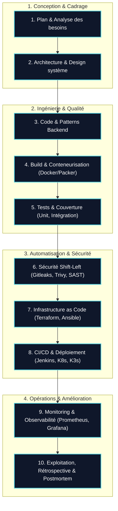

# 📘 Cadre Méthodologique : Le Cycle de Vie Complet d'un Projet (SDLC & DevOps)

> Ce document formalise **l'idée générale et le standard d'ingénierie** appliqué à chaque projet du carnet de bord. Chaque projet ou expérience professionnelle s'articule autour de ce cycle complet en 10 étapes clés, garantissant traçabilité, qualité, sécurité et reproductibilité.

---

## 1. Vue d'Ensemble du Cycle (SDLC & DevOps)



---

## 2. Les 10 Phases Détaillées d'une Fiche Projet

Chaque projet documenté dans ce carnet de bord décline systématiquement ces 10 dimensions :

| # | Phase | Objectif & Questions Clés | Livrables & Outils Types |
|---|---|---|---|
| **1** | **Plan & Cadrage** | Quel problème métier ou technique résout-on ? Quels sont les critères de succès ? | Backlog (GitHub Projects / Jira), User Stories, Spécifications fonctionnelles. |
| **2** | **Architecture & Design** | Quel découpage retenir (Hexagonale, Microservices, EDA) ? Pourquoi ces choix ? | Schémas C4 / Mermaid, ADR (*Architecture Decision Records*), contrats d'API (OpenAPI). |
| **3** | **Développement & Code** | Comment garantir la maintenabilité, les types stricts et la modularité ? | Java 21 / Spring Boot, Python / FastAPI, TypeScript, Domain-Driven Design (DDD). |
| **4** | **Build & Artefacts** | Comment produire des artefacts immutables, légers et optimisés ? | `Dockerfile` multi-stage, images disques avec **Packer**, tagging SemVer. |
| **5** | **Tests & Qualité** | Comment garantir l'absence de régression de manière automatisée ? | Tests unitaires (JUnit 5, Pytest), tests d'intégration avec **Testcontainers**, mocks API. |
| **6** | **Sécurité Shift-Left** | Comment prévenir les fuites de secrets et failles de dépendances avant la production ? | Scans **Gitleaks** (secrets), **Trivy** (vulnérabilités CVE conteneurs), JWT RS256, RBAC. |
| **7** | **Infrastructure as Code** | Comment rendre l'infrastructure 100% reproductible et déclarative ? | Scripts **Terraform** (providers Cloud / Proxmox), playbooks **Ansible**, Cloud-Init. |
| **8** | **CI/CD & Déploiement** | Comment automatiser la livraison sans interruption de service (*zero-downtime*) ? | Pipelines Jenkins as Code (**JCasC**, Job DSL), **GitHub Actions**, Helm, K3s / Kubernetes. |
| **9** | **Monitoring & Observabilité** | Comment observer le comportement en temps réel et détecter les anomalies ? | Métriques **Prometheus**, dashboards **Grafana**, alertes, logs structurés JSON. |
| **10** | **Exploitation & Bilan** | Quels incidents ont eu lieu ? Quels sont les gains mesurés et leçons apprises ? | Postmortems sans blâme (*blameless*), métriques d'impact, pistes d'amélioration. |

---

## 3. Guide Pratique : Comment Ajouter un Nouveau Projet

Pour ajouter un nouveau projet au carnet de bord :

1. **Créer le fichier Markdown** dans `docs/04-projets/[nom-du-projet].md` en s'appuyant sur la structure type ci-dessus.
2. **Ajouter le lien dans la section `## Expériences Professionnelles` ou `## Projets Phares`** de [`docs/index.md`](../index.md) :
   ```html
   <h4><a href="04-projets/[nom-du-projet].md" class="project-title-link">[Titre du Projet] ↗</a></h4>
   ...
   <a href="04-projets/[nom-du-projet].md" class="project-cta-link">
     <span>Voir l'étude de cas & cycle de vie complet →</span>
   </a>
   ```
3. **Référencer le projet dans l'index des projets** ([`docs/04-projets/index.md`](index.md)).
4. **Vérifier le rendu localement** avec `mkdocs serve` puis pousser sur `main`.
