# 🚀 Pipeline CI/CD DevOps End-to-End & Observabilité Cloud

> **Cadre** : Projet DevOps Avancé & Infrastructure Cloud  
> **Objectif** : Déployer en moins de 5 minutes avec 0 temps d'arrêt et rollback automatique  
> **Statut** : :material-check-decagram: Production  

---

## 1. Contexte & Enjeux

Dans un environnement de livraison continue moderne, la moindre erreur de déploiement manuel peut engendrer une interruption de service. Ce projet conçoit et implémente une chaîne d'automatisation complète allant du commit développeur jusqu'au déploiement supervisé en cluster Kubernetes.

---

## 2. Architecture du Pipeline

```mermaid
flowchart LR
    Dev["👨‍💻 Commit / Push"] --> Repo["GitHub Repository"]
    Repo -->|Webhook| CI["Pipeline Jenkins as Code (JCasC)"]
    
    subgraph Validation ["Audit & Sécurité Shift-Left"]
        CI --> Secret["Gitleaks (Secrets)"]
        Secret --> Lint["Linter & Format"]
        Lint --> Tests["Tests Unitaires & Intégration"]
        Tests --> Trivy["Scan CVE Conteneur (Trivy)"]
    end
    
    Trivy --> Build["Docker Multi-Stage Build"]
    Build --> Registry["Registry d'Images (GHCR)"]
    Registry --> K8s["Déploiement Kubernetes (K3s / OKE)"]
    
    subgraph Observability ["Supervision Proactive"]
        K8s --> Prom["Prometheus (Scraping)"]
        Prom --> Graf["Grafana Dashboards"]
        Prom --> Alert["Alertmanager (Telegram / Email)"]
    end
```

---

## 3. Déclinaison Complète du Cycle de Vie (10 Étapes SDLC)

1. **Plan & Conventions** : Spécification des branches Git (`main`, `feature/*`, `hotfix/*`) et des règles de protection de branches.
2. **Code & Qualité** : Application des linters automatiques et formatage strict avant chaque pull request.
3. **Build Multi-stage** : Images Docker ultra-légères basées sur `distroless` ou `alpine` sans outils de build inutiles en runtime.
4. **Tests Automatisés** : Exécution des suites de tests unitaires et vérification du seuil minimal de couverture (> 80%).
5. **Sécurité Shift-Left** :
   * Audit statique de code et détection de fuites de credentials avec **Gitleaks**.
   * Scan de vulnérabilités connues (CVE) des paquets système et dépendances avec **Trivy**.
6. **Release & Tagging** : Versionnement sémantique automatique (**SemVer**) à chaque fusion sur la branche principale.
7. **Infrastructure as Code** : Provisioning déclaratif de l'infrastructure d'accueil avec **Terraform**.
8. **Déploiement Kubernetes** : Déploiement via Helm charts avec sondes *liveness* et *readiness*, et politique de rollback automatique en cas d'échec de démarrage.
9. **Observabilité** : Métriques exposées au format Prometheus, alertes sur taux d'erreur 5xx > 1% ou latence P95 > 200ms.
10. **Rétrospective & Postmortems** : Culture blameless, documentation des incidents et amélioration continue du pipeline.

---

## 4. Technologies Clés

  Jenkins
  Jenkins JCasC
  Docker
  Kubernetes / K3s
  Terraform
  Prometheus
  Grafana
  Trivy
  Gitleaks

