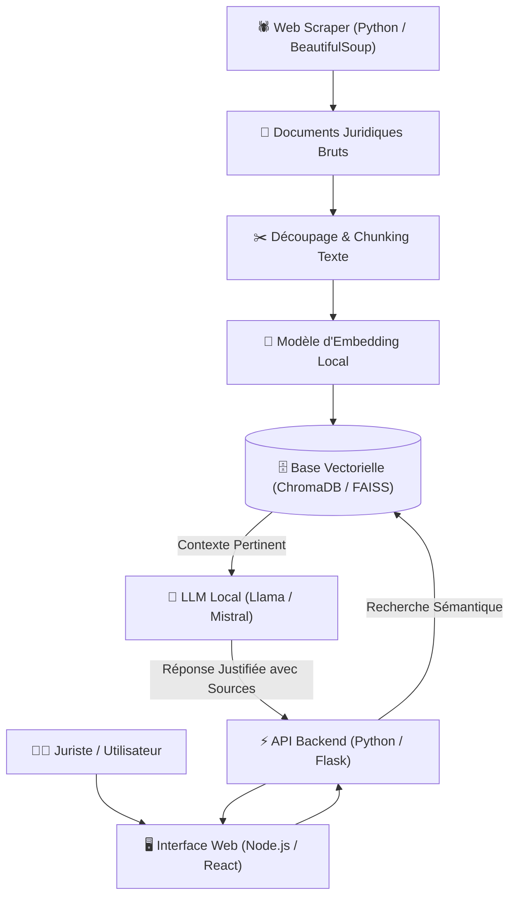

# ⚖️ Application de Recouvrement Intelligente & Moteur Juridique RAG

> **Cadre** : Stage Développeuse Full Stack  
> **Entreprise** : Alidantek (Marrakech, Maroc)  
> **Période** : 07/2025 – 10/2025  
> **Rôle** : Développeuse Full Stack / IA & Backend  
> **Statut** : :material-check-decagram: Livré en Production  

---

## 1. Contexte & Problématique

Les cabinets juridiques et gestionnaires de contentieux font face à un volume considérable de documents juridiques non structurés (contrats, mises en demeure, décisions de justice, codes légaux). La recherche manuelle de jurisprudence et la relance clients étaient chronophages et sources d'erreurs.

### Objectifs Clés
* Automatiser la collecte et l'indexation de textes de lois et jurisprudences marocaines.
* Développer un moteur de recherche sémantique basé sur une architecture **RAG (Retrieval-Augmented Generation)** exploitant des modèles de langage locaux (sans fuite de données confidentielles vers des tiers).
* Mettre en place un module de notification et de suivi des relances clients automatisé par microservices.

---

## 2. Architecture Technique

---

## 3. Cycle de Vie du Projet (SDLC & DevOps)

1. **Plan & Cadrage** : Cartographie des corpus juridiques à indexer, formalisation des contraintes de confidentialité (pas d'envoi vers des APIs cloud externes).
2. **Scraping & Ingestion** : Conception de scripts résilients avec gestion des délais, rotation des user-agents et nettoyage HTML.
3. **Pipeline RAG & Indexation** : Vectorisation des articles de lois et chunking avec recouvrement (*overlap*) pour conserver le contexte réglementaire.
4. **Développement Backend** : Microservices Python / Flask pour le moteur d'inférence RAG, et Node.js pour la gestion des comptes clients et des échéances de recouvrement.
5. **Base de données relationnelle** : Persistance des dossiers clients, relances et états de recouvrement sous **MySQL**.
6. **Conteneurisation** : Encapsulation des services dans des conteneurs **Docker** pour garantir la reproductibilité entre l'environnement de développement et de staging.
7. **CI/CD & Tests** : Validation automatique du code (Pytest, ESLint), tests de précision des réponses du moteur RAG sur un jeu de requêtes de test étalonnées.
8. **Déploiement** : Déploiement sur serveur interne avec Docker Compose et reverse proxy Nginx avec certificat SSL.
9. **Supervision** : Suivi des temps de réponse d'inférence et surveillance de l'utilisation de la VRAM/CPU du serveur.
10. **Rétrospective** : Optimisation de la taille des chunks et du nombre de voisins retournés (*top-k*) ayant permis de doubler la précision des réponses juridiques.

---

## 4. Technologies Utilisées

  Python
  Flask
  Node.js
  RAG Architecture
  LLMs Locaux
  BeautifulSoup
  Vector Embeddings
  MySQL
  Docker

