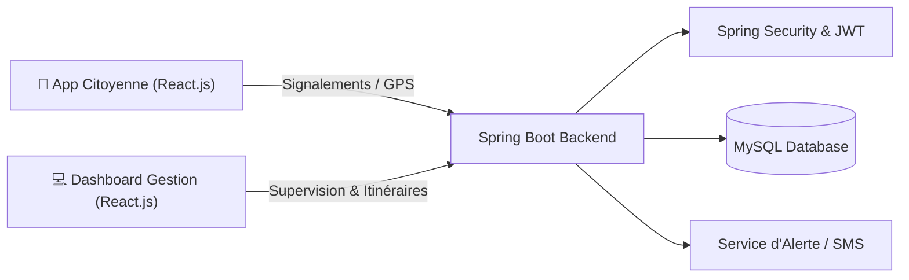

# ♻️ SmartWaste — Gestion & Optimisation des Déchets en Temps Réel

> **Cadre** : Projet Full Stack & Cloud  
> **Type** : Application Citoyenne & Dashboard Administrateur  
> **Statut** : :material-check-decagram: Opérationnel  

---

## 1. Contexte & Objectifs

Optimiser la collecte des déchets urbains en temps réel grâce à la centralisation des données de signalements citoyens et de capteurs de remplissage, réduisant les trajets inutiles des bennes de ramassage.

---

## 2. Architecture Technique

---

## 3. Cycle de Vie du Projet (SDLC & DevOps)

1. **Plan & Conception** : Étude des besoins municipaux, modélisation des entités (*Bacs*, *Collectes*, *Tournées*, *Signalements*).
2. **Backend Java 17 / Spring Boot** : APIs REST pour l'enregistrement géolocalisé des signalements et la mise à jour des niveaux de remplissage.
3. **Sécurité & Rôles** : Différenciation stricte des privilèges entre utilisateurs citoyens et agents de voirie.
4. **Frontend Réactif** : Cartographie interactive Leaflet / OpenStreetMap pour afficher les points de collecte en temps réel.
5. **Validation & Tests** : Tests d'intégration des endpoints de géolocalisation et calcul d'itinéraires optimisés.
6. **Conteneurisation Docker** : Images Docker légères pour le frontend et le backend.
7. **CI/CD GitHub Actions** : Déploiement automatique lors des fusions sur la branche `main`.
8. **Déploiement Cloud** : Hébergement conteneurisé avec certificat SSL Let's Encrypt.
9. **Monitoring** : Télémétrie sur le volume de signalements traités et le taux d'occupation moyen des bacs.
10. **Bilan** : Diminution estimée de 25% des kilomètres parcourus par les véhicules de collecte.

---

## 4. Technologies Utilisées

  Java 17
  Spring Boot
  React.js
  MySQL
  Leaflet / OpenStreetMap
  GitHub Actions
  Docker

