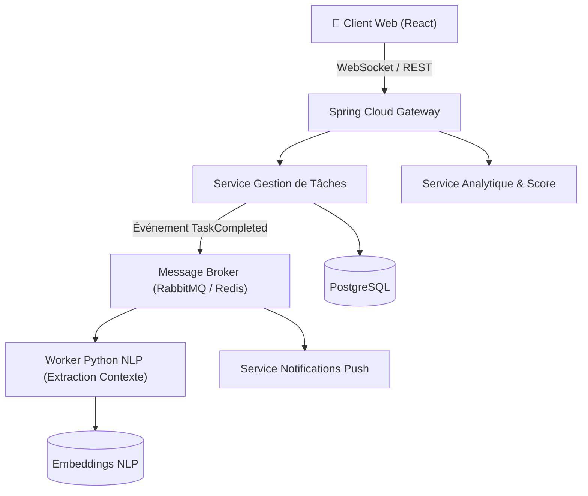

# ⏱️ TimeWise — Plateforme de Productivité & Architecture EDA

> **Cadre** : Projet d'Architecture Backend Avancée  
> **Type** : Microservices pilotés par les événements (EDA)  
> **Statut** : :material-check-decagram: Opérationnel  

---

## 1. Contexte & Objectifs

Développer une plateforme full-stack d'optimisation du temps et de productivité basée sur l'analyse automatique des tâches quotidiennes, intégrant un module NLP d'extraction d'intentions et des notifications en temps réel par WebSockets.

---

## 2. Architecture Event-Driven (EDA)

---

## 3. Cycle de Vie du Projet (SDLC & DevOps)

1. **Cadrage & Découpage Microservices** : Délimitation des contextes métier (*Bounded Contexts*) selon les principes du Domain-Driven Design (DDD).
2. **Développement Backend Java 21** : Microservices indépendants avec Spring Boot 3, isolation des bases de données par service.
3. **Moteur d'Événements Asynchrone** : Publication d'événements typés JSON dans une file de messages, garantissant un couplage faible et une haute résilience.
4. **Composant IA / NLP** : Worker Python analysant le contenu textuel des tâches pour en déduire automatiquement la priorité, la durée estimée et les tags associés.
5. **WebSockets Temps Réel** : Mise à jour instantanée des tableaux de bord utilisateurs sans rechargement de page.
6. **Tests de Résilience** : Tests de coupure temporaire du broker d'événements et vérification de la reprise sur file d'attente (Dead Letter Queue).
7. **Conteneurisation Multi-Services** : `docker-compose.yml` orchestrant l'ensemble de la pile pour le développement local reproductible.
8. **CI/CD** : Pipeline d'intégration continue validant chaque microservice indépendamment.
9. **Supervision** : Tracing distribué pour corréler les requêtes traversant la passerelle et les différents microservices.
10. **Bilan & Retours** : L'architecture découplée permet d'ajouter de nouveaux consommateurs d'événements sans impacter le service principal.

---

## 4. Technologies Utilisées

  Java 21
  Spring Boot 3
  Event-Driven (EDA)
  Python NLP
  RabbitMQ / Redis
  PostgreSQL
  WebSockets
  Docker

