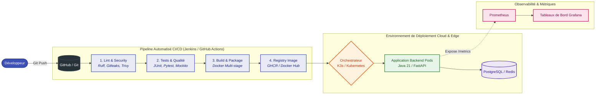

<!-- DYNAMIC_PROFILE_START -->
<!-- DYNAMIC_PROFILE_END -->

## Compétences Techniques

  

    

      :fontawesome-solid-server: Backend & Architecture
    

    

      Conception modulaire, architecture hexagonale et APIs REST/WebSocket à haute disponibilité.
    

    

      :fontawesome-brands-java: Java 21
      :fontawesome-solid-leaf: Spring Boot 3.5
      :fontawesome-brands-python: Python 3.12
      :fontawesome-solid-bolt: FastAPI
      Hexagonal Arch
      REST APIs
      WebSocket & noVNC
      Hibernate / JPA
      Flyway
    

  

  

    

      :fontawesome-brands-docker: DevOps & Conteneurisation
    

    

      Environnements conteneurisés reproductibles, orchestration et virtualisation d'infrastructures.
    

    

      :fontawesome-brands-docker: Docker
      Docker Compose
      :material-kubernetes: K3s / Kubernetes
      Helm Charts
      :material-server: Proxmox VE
      Packer
      Cloud-Init
      :fontawesome-brands-linux: Linux & Bash
    

  

  

    

      :fontawesome-solid-gears: Automatisation, CI/CD & IaC
    

    

      Chaînes de livraison automatisées "Pipeline as Code" et approvisionnement déclaratif.
    

    

      :fontawesome-brands-jenkins: Jenkins
      Jenkins JCasC
      Job DSL
      :fontawesome-brands-github: GitHub Actions
      :material-terraform: Terraform
      :material-ansible: Ansible
      Pipeline as Code
    

  

  

    

      :fontawesome-solid-shield-halved: Données, Sécurité & Observabilité
    

    

      Gestion de données résilientes, sécurité shift-left et surveillance télémétrique proactive.
    

    

      :material-database: PostgreSQL
      :material-database: MySQL
      :material-database-sync: Redis
      :material-chart-line: Prometheus
      :material-chart-bar: Grafana
      OAuth 2.0 / OIDC
      JWT RS256
      HashiCorp Vault
      Trivy & Gitleaks
    

  

## Décisions & Comparatifs Techniques

=== ":fontawesome-brands-docker: Docker vs Podman"

    | Critère | Docker (Moteur Standard) | Podman (Alternative Rootless) |
    |---|---|---|
    | **Architecture** | Client/Serveur avec démon centralisé (`dockerd`) | Sans démon (daemonless), processus fils direct |
    | **Privilèges** | Nécessite souvent les droits `root` (sauf mode rootless configuré) | Exécution sans privilèges (*rootless*) par défaut |
    | **Compatibilité K8s** | Standards OCI & containerd | Génération directe de pods Kubernetes (`podman generate kube`) |
    | **Cas d'usage retenu** | Standard pour les pipelines CI/CD Jenkins & GitHub Actions | Idéal pour environnements HPC et serveurs ultra-durcis |

    !!! tip "Recommandation d'Ingénierie"
        Docker reste la référence pour la compatibilité out-of-the-box avec les agents CI/CD Jenkins (Docker-in-Docker / Docker-outside-of-Docker). Pour les hôtes partagés en production où la surface d'attaque root doit être minimisée, Podman s'impose.

=== ":fontawesome-solid-cubes: Architecture Monolithe vs Hexagonale"

    | Aspect | Monolithe Traditionnel en Couches | Architecture Hexagonale (Ports & Adapters) |
    |---|---|---|
    | **Couplage Métier / BDD** | Fort (entités JPA traversent souvent les couches) | Nul (le domaine métier est isolé au centre) |
    | **Testabilité** | Nécessite des mocks complexes de bases de données | Tests unitaires purs sur le domaine sans infrastructure |
    | **Interchangeabilité** | Difficile de changer de SGBD ou d'interface client | Remplacement simple des adaptateurs (ex. REST, CLI, WebSockets) |

    !!! note "Principe Appliqué"
        Dans le projet de cloud privé (PFE DBM Maroc), l'architecture hexagonale permet d'isoler la logique d'allocation des laboratoires virtuels de l'infrastructure de virtualisation sous-jacente (Proxmox VE, K3s, Docker).

=== ":fontawesome-brands-jenkins: Jenkins (JCasC) vs GitHub Actions"

    | Fonctionnalité | Jenkins avec JCasC & Job DSL | GitHub Actions |
    |---|---|---|
    | **Hébergement** | Auto-hébergé sur cluster K3s / serveurs dédiés | SaaS managé par GitHub (avec options de self-hosted runners) |
    | **Configuration as Code** | Tout est versionné via `jenkins.yaml` et scripts DSL | Fichiers YAML dans `.github/workflows/` |
    | **Contrôle d'accès & Secrets** | Intégration avancée avec HashiCorp Vault et LDAP | GitHub Secrets par dépôt ou organisation |
    | **Budget** | 0 EUR de coût de licence (Open Source sur infra interne) | Gratuit pour l'Open Source, quotas sur dépôts privés |

## Architecture d'Infrastructure & Pipeline CI/CD

!!! tip "Philosophie Shift-Left"
    La sécurité et la qualité ne sont pas reléguées en fin de cycle : chaque commit est audité (détection de secrets via **Gitleaks**, analyse statique de vulnérabilités conteneur via **Trivy**, couverture de tests unitaires et d'intégration avant toute mise en production).

## Expériences Professionnelles

!!! info "Cycle de Vie & Traçabilité (SDLC & DevOps)"
    Chaque projet ci-dessous est documenté selon notre démarche d'ingénierie en 10 étapes. Cliquez sur le titre ou sur le bouton de chaque projet pour consulter son **étude de cas détaillée** (Architecture, IaC, CI/CD, Sécurité, Monitoring).
    Consultez également le [**Guide Méthodologique du Cycle de Vie**](04-projets/guide-cycle-de-vie.md).

  

    

    
02/2026 – 07/2026 | Mohammadia, Maroc

    

      <h4><a href="04-projets/cloud-prive-dbm.md" class="project-title-link">Ingénieure Full Stack / DevOps — PFE @ DBM Maroc ↗</a></h4>
      
Conception et développement d'une plateforme de Cloud privé pour laboratoires virtuels d'apprentissage

      

        • <strong>Automatisation d'infrastructure :</strong> Provisioning et virtualisation automatisés de machines virtuelles et conteneurs avec Proxmox VE, Terraform, Ansible, Packer et Cloud-Init. 
        • <strong>Orchestration & CI/CD :</strong> Conteneurisation de la plateforme avec Docker, déploiement sur cluster K3s, création de pipelines Jenkins as Code (JCasC, Job DSL). 
        • <strong>Développement Backend :</strong> Architecture hexagonale en Java 21 / Spring Boot 3.5, intégration du protocole LTI 1.3 Advantage (OIDC, OAuth 2.0) pour SSO Moodle, accès distant via WebSockets / noVNC.
      

      

        Java 21
        Spring Boot 3.5
        Docker
        K3s
        Jenkins
        Terraform
        Ansible
        Proxmox VE
        PostgreSQL
      

      

        <a href="04-projets/cloud-prive-dbm.md" class="project-card-cta">
          Consulter le cycle de vie complet du projet (SDLC & DevOps)
          <svg viewBox="0 0 448 512"><path d="M438.6 278.6c12.5-12.5 12.5-32.8 0-45.3l-160-160c-12.5-12.5-32.8-12.5-45.3 0s-12.5 32.8 0 45.3L338.8 224 32 224c-17.7 0-32 14.3-32 32s14.3 32 32 32l306.7 0-105.4 105.4c-12.5 12.5-12.5 32.8 0 45.3s32.8 12.5 45.3 0l160-160z"/></svg>
        </a>
      

    

  

  

    

    
07/2025 – 10/2025 | Marrakech, Maroc

    

      <h4><a href="04-projets/recouvrement-rag-alidantek.md" class="project-title-link">Développeuse Full Stack (Stage) — Alidantek ↗</a></h4>
      
Application de recouvrement intelligente & Moteur de recherche juridique RAG

      

        • Conception d'une architecture microservices automatisant les communications clients avec intégration de LLMs locaux et pipeline RAG. 
        • Développement d'un moteur de recherche juridique intelligent avec web scraping automatisé (Python, BeautifulSoup, Flask) et indexation documentaire.
      

      

        Python
        Flask
        Node.js
        RAG
        LLMs locaux
        MySQL
      

      

        <a href="04-projets/recouvrement-rag-alidantek.md" class="project-card-cta">
          Consulter le cycle de vie complet du projet (SDLC & DevOps)
          <svg viewBox="0 0 448 512"><path d="M438.6 278.6c12.5-12.5 12.5-32.8 0-45.3l-160-160c-12.5-12.5-32.8-12.5-45.3 0s-12.5 32.8 0 45.3L338.8 224 32 224c-17.7 0-32 14.3-32 32s14.3 32 32 32l306.7 0-105.4 105.4c-12.5 12.5-12.5 32.8 0 45.3s32.8 12.5 45.3 0l160-160z"/></svg>
        </a>
      

    

  

  

    

    
07/2025 – 09/2025 | Mohammedia, Maroc

    

      <h4><a href="04-projets/assistant-medical-3dsmart.md" class="project-title-link">Développeuse Full Stack (Stage) — 3D Smart Factory ↗</a></h4>
      
Plateforme web d'assistant médical intelligent & Télémédecine

      

        • Développement d'une plateforme d'assistance médicale avec module de chat IA intelligent, prise de rendez-vous et conseils personnalisés. 
        • Backend Java / Spring Boot sécurisé avec JWT, frontend Angular et intégration de modèles NLP Python.
      

      

        Java
        Spring Boot
        Angular
        JWT
        Python NLP
      

      

        <a href="04-projets/assistant-medical-3dsmart.md" class="project-card-cta">
          Consulter le cycle de vie complet du projet (SDLC & DevOps)
          <svg viewBox="0 0 448 512"><path d="M438.6 278.6c12.5-12.5 12.5-32.8 0-45.3l-160-160c-12.5-12.5-32.8-12.5-45.3 0s-12.5 32.8 0 45.3L338.8 224 32 224c-17.7 0-32 14.3-32 32s14.3 32 32 32l306.7 0-105.4 105.4c-12.5 12.5-12.5 32.8 0 45.3s32.8 12.5 45.3 0l160-160z"/></svg>
        </a>
      

    

  

  

    

    
04/2024 – 06/2024 | Marrakech, Maroc

    

      <h4><a href="04-projets/ecommerce-seratel.md" class="project-title-link">Développeuse Full Stack (Stage) — Seratel ↗</a></h4>
      
Plateforme e-commerce complète & Gestion Commerciale

      

        • Conception et développement complet d'une solution e-commerce avec gestion des catalogues, paniers, authentification et commandes en Spring Boot et React.
      

      

        Spring Boot
        Spring Security
        React
        MySQL
      

      

        <a href="04-projets/ecommerce-seratel.md" class="project-card-cta">
          Consulter le cycle de vie complet du projet (SDLC & DevOps)
          <svg viewBox="0 0 448 512"><path d="M438.6 278.6c12.5-12.5 12.5-32.8 0-45.3l-160-160c-12.5-12.5-32.8-12.5-45.3 0s-12.5 32.8 0 45.3L338.8 224 32 224c-17.7 0-32 14.3-32 32s14.3 32 32 32l306.7 0-105.4 105.4c-12.5 12.5-12.5 32.8 0 45.3s32.8 12.5 45.3 0l160-160z"/></svg>
        </a>
      

    

  

## Formations & Diplômes

  

    

    
2023 – 2024

    

      <h4>Master en Ingénierie des Systèmes Informatiques Répartis</h4>
      
Faculté des Sciences et Techniques (FST) — Mohammadia

      

        Spécialisation dans les architectures réparties, systèmes distribués, cloud computing, réseaux et sécurité avancée des infrastructures.
      

    

  

  

    

    
2021 – 2023

    

      <h4>DEUST MIPC (Mathématiques, Informatique, Physique, Chimie)</h4>
      
Faculté des Sciences et Techniques (FST) — Marrakech

      

        Socle scientifique et algorithmique solide, programmation procédurale et orientée objet, structures de données fondamentales.
      

    

  

  

    

    
2020

    

      <h4>Baccalauréat Scientifique — Sciences Physiques</h4>
      
Lycée Labrikiyne

    

  

## Certifications Officielles

| Certification | Organisme Émetteur | Année | Domaine Clé |
|---|---|---|---|
| **Oracle Cloud Infrastructure 2025 - DevOps Professional** | Oracle Cloud | 2025 | Automatisation CI/CD, OCI DevOps, OKE, OCI Registry |
| **Oracle Cloud 2025 - Developer Professional** | Oracle Cloud | 2025 | Cloud Native, Microservices, API Gateway, Serverless |
| **Oracle Cloud 2025 - Foundations Associate** | Oracle Cloud | 2025 | Architecture Cloud, Compute, Networking, Storage & IAM |

## Projets Phares

  

    

      :material-rocket-launch: <a href="04-projets/pipeline-devops-end-to-end.md" class="project-title-link">Pipeline CI/CD DevOps End-to-End ↗</a>
    

    

      Chaîne d'automatisation complète de commit à déploiement avec Jenkins, Docker, K8s, Prometheus et Grafana sur Azure. Déploiement en moins de 5 min avec rollback automatique.
    

    

      Jenkins
      Docker
      Kubernetes
      Prometheus
      Azure
    

    

      <a href="04-projets/pipeline-devops-end-to-end.md" class="project-card-cta">
        Cycle de vie & Architecture →
      </a>
    

  

  

    

      :material-clock-outline: <a href="04-projets/timewise-microservices.md" class="project-title-link">TimeWise — Coach de Productivité ↗</a>
    

    

      Application de productivité full-stack basée sur une architecture de microservices pilotée par les événements (EDA). WebSocket, NLP, Docker et CI/CD automatisée.
    

    

      Spring Boot 3
      Python NLP
      PostgreSQL
      EDA
      Docker
    

    

      <a href="04-projets/timewise-microservices.md" class="project-card-cta">
        Cycle de vie & Architecture →
      </a>
    

  

  

    

      :material-recycle: <a href="04-projets/smartwaste-iot.md" class="project-title-link">SmartWaste — Gestion Temps Réel ↗</a>
    

    

      Application citoyenne et tableau de bord administrateur pour la gestion optimisée des déchets en temps réel. Déploiement cloud via Docker et CI/CD GitHub Actions.
    

    

      Java 17
      Spring Boot
      React.js
      MySQL
      GitHub Actions
    

    

      <a href="04-projets/smartwaste-iot.md" class="project-card-cta">
        Cycle de vie & Architecture →
      </a>
    

  

  

    

      :material-book-open-page-variant: <a href="04-projets/guide-cycle-de-vie.md" class="project-title-link">Engineering Logbook & Méthodologie ↗</a>
    

    

      Ce site web interactif — portfolio d'ingénierie et carnet de bord technique documentant l'ensemble du cycle SDLC (10 étapes), avec CMS headless découplé.
    

    

      MkDocs Material
      GitHub Pages
      Decap CMS
      Cloudflare Workers
    

    

      <a href="04-projets/guide-cycle-de-vie.md" class="project-card-cta">
        Découvrir la Méthodologie →
      </a>
    

  

