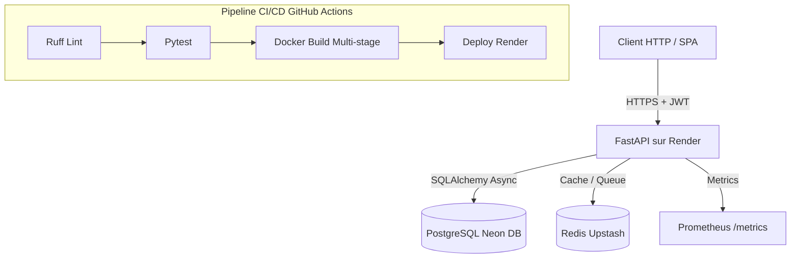

# Fatima-Ezzahrae Rabia

**Ingénieure Backend & DevOps**  
Python · FastAPI · Docker · PostgreSQL · Kubernetes · CI/CD

---

## Profil

Ingénieure passionnée par la conception de systèmes Backend robustes et l'automatisation des infrastructures DevOps. Je conçois, teste, conteneurise et déploie des APIs REST asynchrones en suivant l'intégralité du cycle de vie logiciel (SDLC 10 étapes), de la conception à l'observabilité en production.

Contrainte budgétaire assumée : 100% des projets de ce portfolio sont déployés sur des infrastructures cloud gratuites (GitHub Pages, Render, Neon DB, Upstash Redis, Cloudflare Workers).

---

## Competences Techniques

### Langages & Frameworks
| Technologie | Niveau |
|---|---|
| Python 3.12 | Avance |
| FastAPI / Pydantic v2 | Avance |
| SQLAlchemy 2.0 Async | Intermediaire |
| Bash / Shell Scripting | Intermediaire |

### Bases de Donnees & Cache
| Technologie | Usage |
|---|---|
| PostgreSQL (Neon DB Serverless) | Base de donnees principale |
| Alembic | Migrations de schema |
| Redis / Upstash | Cache & File de taches asynchrones |

### DevOps & Infrastructure
| Technologie | Usage |
|---|---|
| Docker (multi-stage) | Conteneurisation |
| GitHub Actions | CI/CD automatise |
| Kubernetes (Kind local) | Orchestration (apprentissage) |
| Terraform | Infrastructure as Code (apprentissage) |
| Prometheus & Grafana | Monitoring & Dashboards |

### Securite & Qualite
| Outil | Role |
|---|---|
| Ruff | Lint & formattage Python |
| Pytest + pytest-asyncio | Tests unitaires & integration |
| Gitleaks | Detection de secrets dans le code |
| Trivy | Scan de vulnerabilites Docker |
| PyJWT + Argon2 | Authentification JWT securisee |

---

## Formation

### Diplome Principal
**[Votre Diplome]** — [Votre Ecole / Universite]  
[Annee d'obtention]  
Domaine : Informatique / Genie Logiciel / Reseaux & Telecoms

### Formation Complementaire
- [Nom de la formation ou du bootcamp] — [Organisme] — [Annee]
- [Cours en ligne ou certification informelle] — [Plateforme : Coursera, OpenClassrooms, freeCodeCamp...] — [Annee]

---

## Certifications

| Certification | Organisme | Annee | Lien |
|---|---|---|---|
| [Nom de la certification] | [AWS / Google / Microsoft / GitHub] | [Annee] | [Voir le certificat](#) |
| [Nom de la certification] | [Organisme] | [Annee] | [Voir le certificat](#) |

> Aucune certification officielle pour le moment. En cours de preparation : [Certification ciblee, ex: AWS Cloud Practitioner, GitHub Foundations, Google Cloud Associate].

---

## Projets

### Projet Fil Rouge : Task Manager API
**API REST de gestion de taches, deployee en production a 0 EUR**

| Element | Detail |
|---|---|
| **Stack** | FastAPI · Python 3.12 · PostgreSQL (Neon) · Redis (Upstash) · Docker |
| **Architecture** | Clean Architecture · SQLAlchemy Async · Alembic · ARQ Worker |
| **Securite** | JWT (PyJWT + Argon2) · Middleware Correlation ID · Ruff S rules |
| **Observabilite** | Prometheus · Structlog JSON · `/metrics` endpoint |
| **Deploiement** | Docker multi-stage · Render.com · GitHub Actions CI/CD |
| **Statut** | En Production |

[Voir la documentation Swagger](https://devops-backend-logbook.onrender.com/docs){ .md-button .md-button--primary }
[Voir le code source](https://github.com/fatimaezzahraerabia/devops-backend-logbook){ .md-button }

---

### Projet : DevOps & Backend Engineering Logbook
**Ce site — Carnet de bord d'ingenierie public**

| Element | Detail |
|---|---|
| **Stack** | MkDocs Material · GitHub Pages · Decap CMS · Cloudflare Workers |
| **Fonctionnalite** | Interface d'administration web via OAuth GitHub |
| **CI/CD** | GitHub Actions · Python 3.12 · mkdocs-awesome-pages-plugin |
| **Statut** | En Production |

[Voir le site](https://fatimaezzahraerabia.github.io/devops-backend-logbook/){ .md-button .md-button--primary }

---

## Experiences Professionnelles

### [Titre du Poste] — [Entreprise]
**[Mois Annee] — [Mois Annee]** | [Ville, Pays]

- [Description de la mission principale]
- [Technologies utilisees et resultats obtenus]
- [Responsabilites cles]

### [Stage / Alternance] — [Entreprise]
**[Mois Annee] — [Mois Annee]** | [Ville, Pays]

- [Description de la mission]
- [Technologies utilisees]

> Premiere experience professionnelle en cours de recherche / en preparation via ce portfolio.

---

## Demarche & Methodologie

Ce carnet s'appuie sur des **preuves concretes** plutot que des declarations d'intention :

- **Transparence totale** : Chaque note de journal decrit ce qui a fonctionne, mais aussi ce qui s'est casse et ce qui a ete appris.
- **Couverture SDLC (10 Etapes)** : Du cadrage (Plan) au maintien en condition operationnelle (Operate & Chaos Engineering).
- **Budget 0 EUR** : Utilisation exclusive d'outils Open Source et d'hebergements cloud gratuits.

---

## Architecture du Projet Fil Rouge

---

## Sommaire du Carnet

| Section | Description |
|---|---|
| **[Plan & Roadmap](00-plan/roadmap.md)** | Feuille de route 90 jours autour du SDLC. |
| **[Journal](01-journal/index.md)** | Notes hebdomadaires : fait, casse, appris. |
| **[Backend](02-backend/index.md)** | FastAPI, SQLAlchemy, Alembic, tests Pytest. |
| **[DevOps & Infra](03-devops/index.md)** | Docker, CI/CD, Terraform, Prometheus, Grafana. |
| **[Projets](04-projets/api-gestion-taches.md)** | Fiches detaillees de chaque projet. |
| **[Incidents & Postmortems](05-incidents/postmortem-001.md)** | Retours d'experience sur les pannes resolues. |
| **[Decisions (ADR)](06-decisions/adr-001-fastapi-vs-flask-django.md)** | Choix d'architecture documentes et argumentes. |
| **[Cheatsheets](07-cheatsheets/index.md)** | Commandes essentielles Git, Docker, K8s, SQL. |

---

## Contact

- **GitHub** : [github.com/fatimaezzahraerabia](https://github.com/fatimaezzahraerabia)
- **LinkedIn** : [linkedin.com/in/fatima-ezzahrae-rabia](https://linkedin.com/in/fatima-ezzahrae-rabia)
- **Email** : [votre.email@exemple.com](mailto:votre.email@exemple.com)
- **Localisation** : [Votre Ville, Pays]
